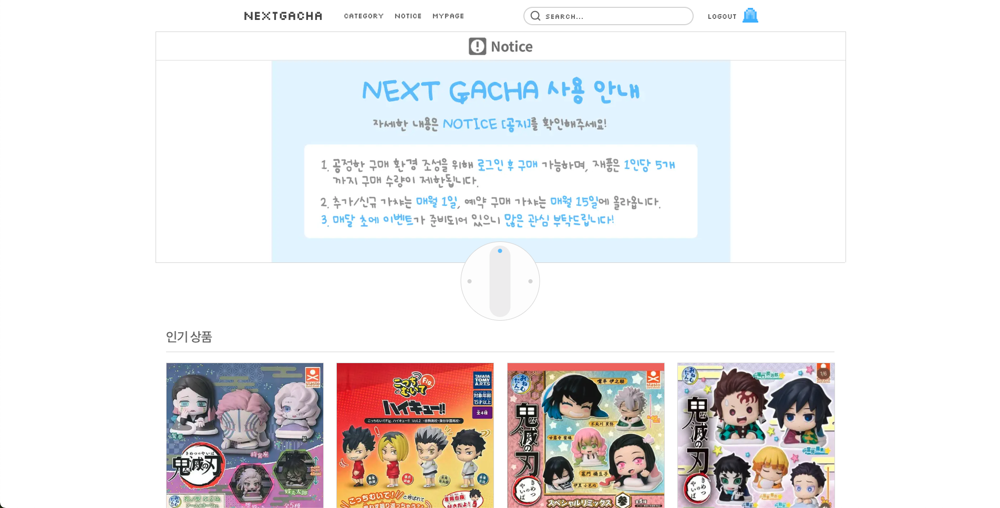
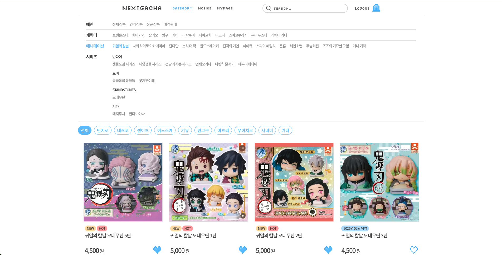
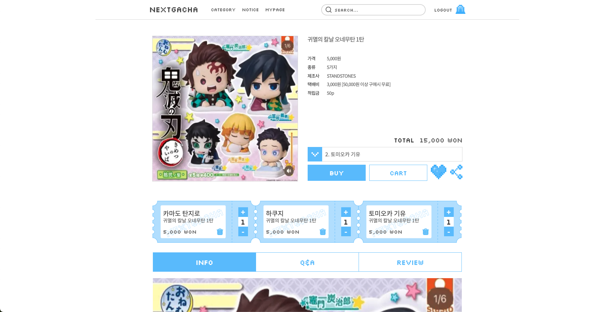
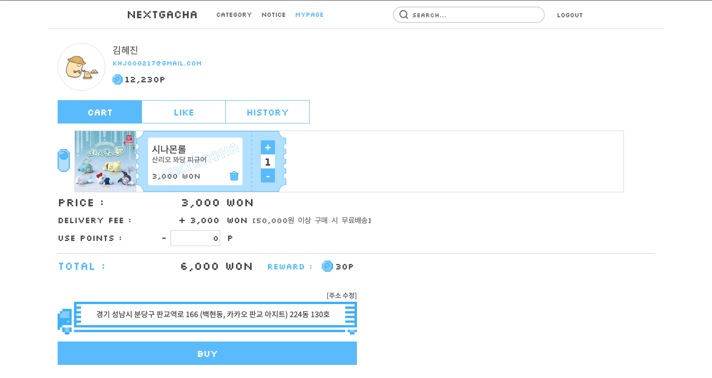
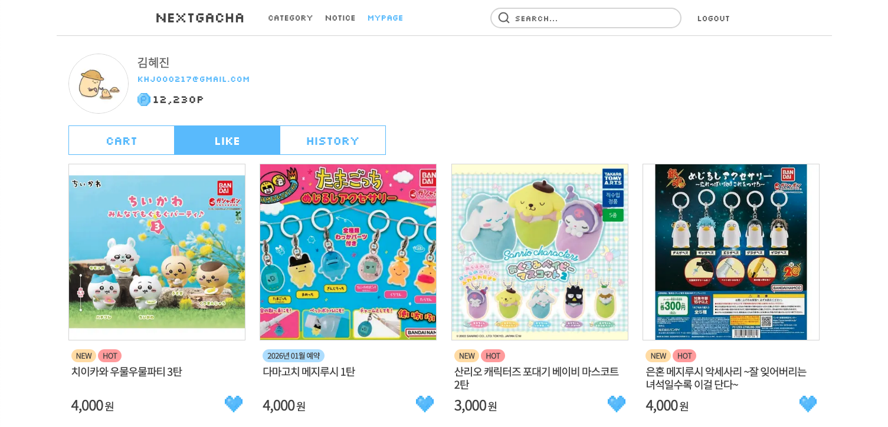
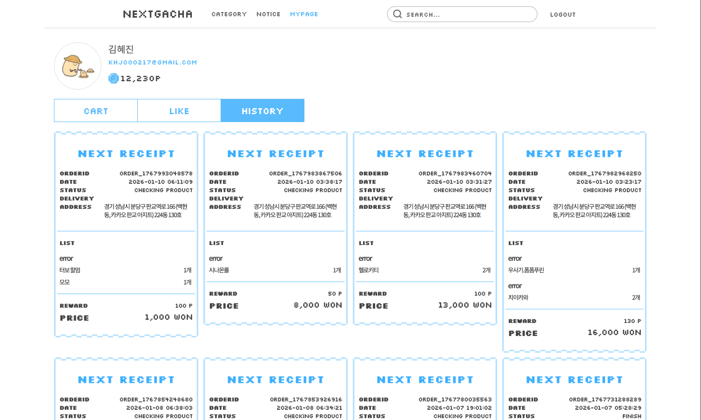
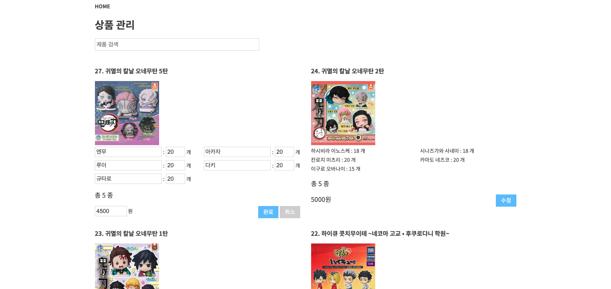
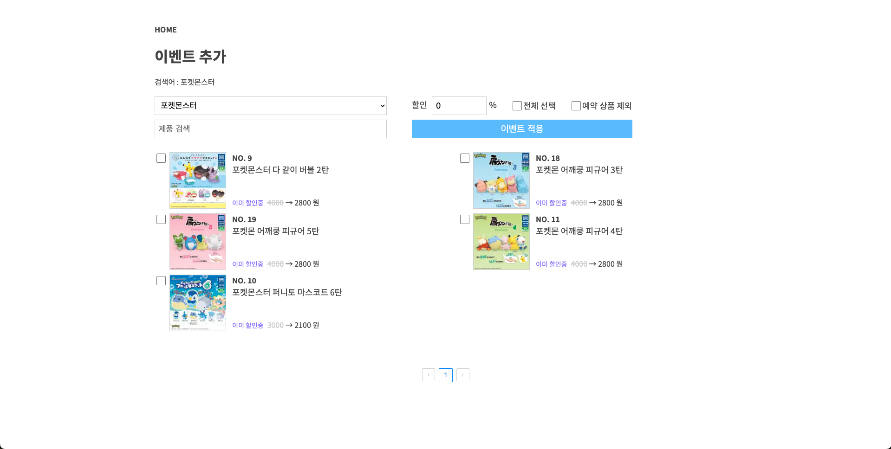
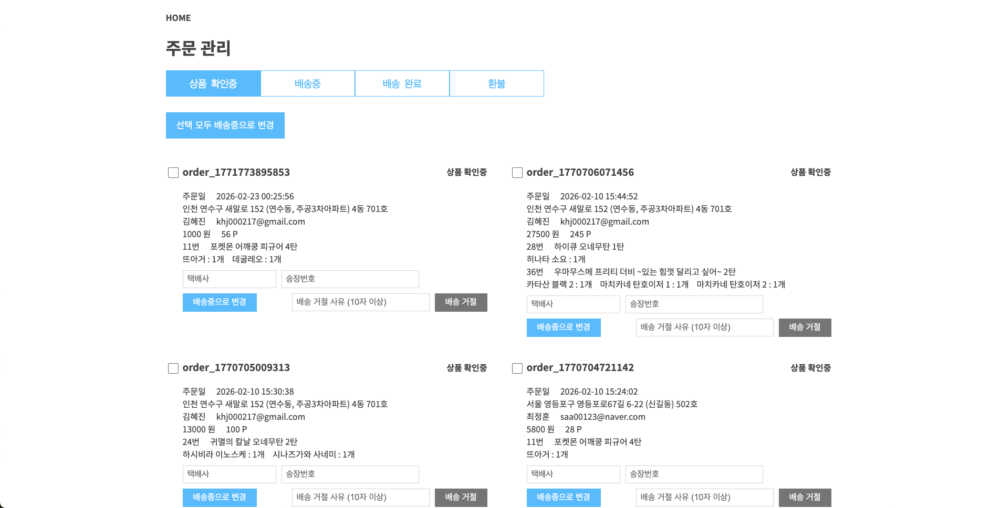
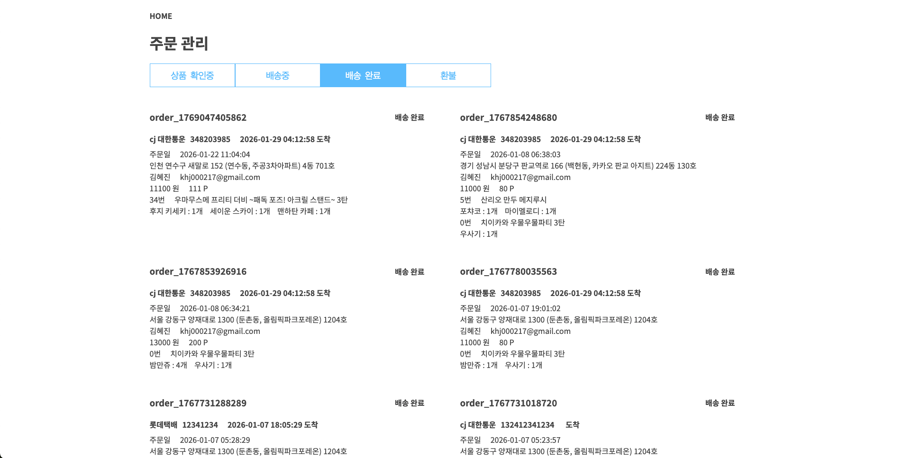

# Next Gacha

요즘 정가에 물건을 구매해 웃돈을 붙여서 파는, 일명 되팔램이 중고거래에 성행하면서 정작 갖고 싶어하는 사람들이 돈을 더 주고 사야하는 불편함이 늘어나고 있습니다. 또 같은 제품을 파는 가게가 저렴한 가게의 제품을 대량 구매한 후 가격을 올려서 팔아 소비자들이 같은 제품을 비싸게 주고 사야하는 경우가 많아지고 있습니다.
이런 불편함을 줄이기 위해 한 사람당 한 물건을 최대 5개까지만 구매할 수 있는 정책을 추가한 쇼핑몰을 만들게 되었습니다.

#### 왜 최대 5개인가?

전시용, 보관용, 예비용1, 예비용2, 선물용으로 생각해서 넉넉하게 5개로 정하게 되었습니다.

배포 사이트 : https://nextgacha.vercel.app<br />
관리자 페이지 : https://nextgacha.vercel.app/manager

#### 구매 정책

1. 사람1이 A가챠의 a캐릭터를 5개 구매
   - 상품 확인, 배송중 상태일 때 사람1은 A가챠 a캐릭터는 구매 불가능, A가챠 b캐릭터 / B가챠 a캐릭터는 각각 5개 구매 가능
   - A가챠의 a캐릭터 3개가 배송 완료가 되면 사람1은 A가챠 a캐릭터를 다시 최대 5개까지 구매할 수 있음

2. 사람1이 A가챠의 a캐릭터 3개 구매
   - 상품 확인, 배송중 상태일 때 사람1은 A가챠 a캐릭터는 2개까지 구매 가능, A가챠 b캐릭터 / B가챠 a캐릭터는 각각 5개 구매 가능
   - A가챠의 a캐릭터 3개가 배송 완료가 되면 사람1은 A가챠 a캐릭터를 다시 최대 5개까지 구매할 수 있음

## 인원

1명 (기획, 프론트, 백, 디자인)

figma : https://www.figma.com/design/86ZlSugwRP6z3dXpoA90HP/Army-team-library?node-id=2694-2&t=HYY6mUp2SEcU4v8V-1

## 화면 구현

#### 사용자 페이지

<div>
   
   
</div>
<div>
   
   
</div>
<div>
   
   
</div>

#### 관리자 페이지

<div>
   
   
</div>
<div>
   
   
</div>

## 기술 스택

| 분류            | 기술                         |
| --------------- | ---------------------------- |
| Framework       | Next.js 16 (App Router)      |
| Language        | TypeScript                   |
| Database        | MongoDB                      |
| Auth            | NextAuth v5 (카카오 OAuth)   |
| 결제            | TossPayments SDK             |
| 서버 상태       | TanStack React Query v5      |
| 전역 상태       | Jotai                        |
| 스타일링        | Vanilla Extract              |
| 이미지 저장     | Vercel Blob                  |
| 테스트          | Node test runner (`node:test`) |
| UI 문서         | Storybook 10                 |
| CI              | GitHub Actions (lint · typecheck · test) |
| 배포            | Vercel                       |
| 방문 통계       | Google Analytics 4           |

## 주요 기능

### 사용자

- 카카오 소셜 로그인
- 상품 탐색 및 검색, 카테고리 필터링
- 상품 찜하기
- 장바구니 담기 (1인당 동일 상품 최대 5개 제한)
- 포인트 결제 (TossPayments 연동)
- 주문 내역 / 배송 현황 조회
- 상품 리뷰 및 Q&A 작성

### 관리자

- 회원 관리
- 상품 등록 / 수정 / 관리, 카테고리 관리 (끌어서 놓기 · 키보드로 순서 변경)
- 상품 리뷰 조회, Q&A 답변
- 주문 상태 관리 (주문 확인 → 배송중 → 배송 완료, 주문 확인 단계에서 환불)
- 다른 계정으로 한도를 피한 것으로 보이는 주문 표시 (같은 기기 · IP · 배송지)
- 상품 이벤트(할인) 관리
- 배너 · 공지 관리
- 오류 신고 / 시스템 에러 처리 상태 관리

## 핵심 구현

### 1인당 5개 수량 제한

장바구니(보유) + 배송중(keep) + 임시 수량을 실시간으로 합산해 최대 5개를 넘지 않도록 검증합니다. 재고가 5개 미만이면 재고 수를 상한으로 적용합니다.

```
총 소유 = 장바구니 수량 + 배송중 수량 + 현재 선택 수량
유효 상한 = min(5, 재고)
추가 가능 여부 = 총 소유 < 유효 상한
```

검증은 클라이언트(hook), API, 결제 확인 시 3단계로 이루어집니다.

### 결제 승인: 실패하는 경우까지

결제는 외부(TossPayments)와 DB를 하나의 트랜잭션으로 묶을 수 없습니다. 그래서 거절할 수 있는 검증은 모두 승인 앞에 두고, 승인 뒤에 실패하면 결제를 취소합니다.

1. 재고 확인
2. 금액 · 포인트 · 보유 한도를 DB 기준으로 다시 계산 (클라이언트가 보낸 금액은 믿지 않음)
3. TossPayments 승인 (여기서 실제로 결제됨)
4. 포인트 차감 → 재고 차감 → 주문 생성 → 장바구니 정리를 MongoDB 트랜잭션 하나로 처리
5. 트랜잭션이 실패하면 결제를 자동 취소
6. 취소까지 실패하면 관리자 오류 화면에 기록

```typescript
await mongodbSession.withTransaction(async () => {
  await reducePoint({ ... }); // 포인트 + 보유 수량, 한도 초과면 throw
  await reduceStock({ ... }); // 재고가 충분할 때만 차감, 부족하면 throw
  await addOrder({ ... });
  await resetCart({ ... });
});
```

금액 · 배송비 · 포인트 · 한도 규칙은 순수 함수(`src/features/purchase/lib/orderPolicy.ts`)에 모아 화면과 서버가 같이 쓰고, 테스트로 확인합니다.

### 동시 요청과 중복 요청

- 탭 두 개에서 동시에 결제해도 한도와 재고를 넘지 않습니다. 한도는 트랜잭션 안에서 사용자 문서를 읽고 쓰고, 재고는 "주문 수량 이상 남았을 때만 차감"하는 조건부 업데이트로 처리합니다.
- 주문 상태 변경은 현재 상태를 업데이트 조건에 넣습니다. 배송 완료 버튼을 두 번 눌러도 적립 포인트는 한 번만 지급됩니다.
- 환불은 결제 취소를 먼저 하고, 그다음 재고 · 보유 수량 · 사용 포인트를 트랜잭션으로 되돌립니다.

### 이원화된 장바구니 구조

| 구분          | 저장소         | 설명                           |
| ------------- | -------------- | ------------------------------ |
| 임시 장바구니 | Jotai (메모리) | 상품 상세 페이지에서 수량 조정 |
| 실제 장바구니 | MongoDB        | 담기 버튼 클릭 후 DB에 저장    |

실수로 장바구니에 추가되는 상황을 방지하고 탐색 중 자유로운 수량 조정을 지원합니다.

### MongoDB Aggregation

장바구니 조회 시 `$facet`으로 장바구니, 배송중 항목, 재고 데이터를 단일 쿼리로 동시에 가져옵니다. 품절된 상품은 자동으로 장바구니에서 제거됩니다.

### 보안

- 로그인 / 관리자 확인은 미들웨어(`src/proxy.ts`)에서 하고, 내 데이터인지는 라우트에서 세션 이메일로 다시 확인합니다.
- 요청 값은 문자열 · 정수인지 확인한 뒤에만 MongoDB 쿼리에 넣습니다 (NoSQL 연산자 주입 방지).
- 리뷰 · Q&A 조회 응답에는 이메일 원문을 담지 않고, 비밀글 내용은 서버에서 비웁니다.

### 성능

홈 화면을 서버 렌더링으로 바꾸고 배너 우선 로딩, 가변 폰트를 적용했습니다. (Lighthouse, 운영 환경, 3회 중앙값)

| 지표               | 개선 전 | 개선 후 |
| ------------------ | ------- | ------- |
| 모바일 성능 점수   | 73      | 80      |
| 데스크톱 성능 점수 | 90      | 99      |
| CLS (모바일)       | 0.13    | 0.001   |

## 아키텍처

### Feature-Sliced Design

처음에는 Atomic Design(`atoms / molecules / organisms`)으로 만들었고, 이후 Feature-Sliced Design으로 옮겼습니다. 위 레이어는 아래 레이어만 import합니다.

```
src/
├── app/        # 라우트, API 라우트(43개), 루트 layout
├── views/      # 페이지 단위 조합 (HomePage, DetailPage, SearchPage ...)
├── widgets/    # 독립적인 큰 UI 영역 (Header, CartCheckout, OrderBoard ...)
├── features/   # 사용자 행동 (cart, purchase, qna, review-write, order-manage ...)
├── entities/   # 도메인 객체 (product, order, user, review, qna, notice, banner)
├── shared/     # 도메인을 모르는 재사용 코드 (api, lib, hooks, ui)
└── styles/     # 전역 theme, 공용 variants
```

`app → views → widgets → features → entities → shared`

### 문서

| 문서 | 내용 |
| --- | --- |
| [docs/policies](./docs/policies/README.md) | 결제 · 환불 · 한도 · 배포 · 장애 대응 등 결정 기록 (이유, 코드 위치, 변경 이력) |
| [docs/design-system.md](./docs/design-system.md) | 색 · 폰트 · 간격 토큰과 컴포넌트 규칙 |
| [docs/system-architecture.drawio](./docs/system-architecture.drawio) | 시스템 구성도 |
| [CLAUDE.md](./CLAUDE.md) | 구조, 인증, 데이터 레이어 요약 |

## 스타일링

Vanilla Extract를 사용해 빌드 타임에 CSS를 생성합니다. 런타임 오버헤드 없이 타입 안전한 스타일링이 가능합니다.

## 인증 흐름

1. 카카오 OAuth 로그인
2. 최초 로그인 시 DB에 사용자 생성 (카카오가 이메일을 주지 않으면 로그인 거부)
3. 세션 토큰으로 인증 유지
4. `/api/protected/*`, `/mypage/*` 는 미들웨어로 보호, `/manager/*` 와 관리자 API는 관리자 이메일만 허용
